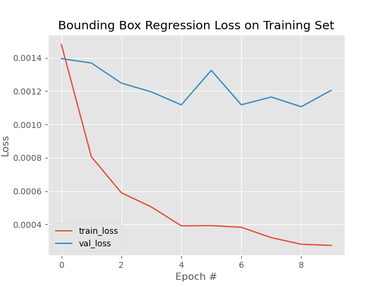

# AI Pill Detection

A convolutional network that finds a pill in a photo by predicting its **bounding box**. I wrote the VGG16 architecture from scratch in Keras and trained it as a regression model rather than using a pretrained detector.

## Approach

- **Input:** RGB image resized to 224×224 and scaled to `[0, 1]`.
- **Backbone:** the five VGG16 convolution blocks (64 → 128 → 256 → 512 → 512 filters, 3×3 kernels, max-pooling), built layer by layer.
- **Head:** `Flatten → Dense 128 → 64 → 32 (ReLU) → Dense 4 (sigmoid)`.
- **Output:** `[xmin, ymin, xmax, ymax]`, normalised by image width and height so every value is between 0 and 1. That's why the output layer uses a sigmoid.
- **Loss:** mean squared error, optimised with Adam.

## Dataset

A pill dataset with CSV annotations (`filename, width, height, class, xmin, ymin, xmax, ymax`), split into `train` (1,294 images), `valid` (164) and `test` (53) in `DataSet/`.

## Experiments

Each `*.png` in the repository is the training and validation loss curve of one run. File names record the settings:

```
rgb_mse_5e-5_10ep+50+10_D-128-64-32.png
│   │   │    │          └ dense head sizes
│   │   │    └ epochs (10, then continued training: +50, +10)
│   │   └ learning rate
│   └ loss function
└ colour input (rgb or gray)
```

The runs compare greyscale with RGB input, learning rates from 1e-3 to 5e-5, two head sizes, and continued training. The best setting was RGB input, learning rate 5e-5 and the 128-64-32 head. With longer training, the training loss keeps falling while the validation loss levels off at about 1.1e-3, which shows overfitting on a dataset of this size. The obvious next steps are data augmentation or a pretrained backbone.



## Usage

```bash
pip install tensorflow keras opencv-python matplotlib numpy
python main.py -t-save-show     # train, save weights to new-tablet.weights.h5, plot losses
python main.py -l -p            # load tablet.weights.h5, draw predicted boxes on DataSet/test
```

| Flag | Action |
|---|---|
| `-l` | load weights from `tablet.weights.h5` |
| `-t` | train |
| `-t-save` | train and save weights |
| `-t-show` | train and plot the loss curves |
| `-t-save-show` | train, save and plot |
| `-p` | predict boxes for `DataSet/test` and draw them |

Hyperparameters (batch size, epochs, learning rate, dataset path) are in `config.py`. Trained weights are not included in the repository.
